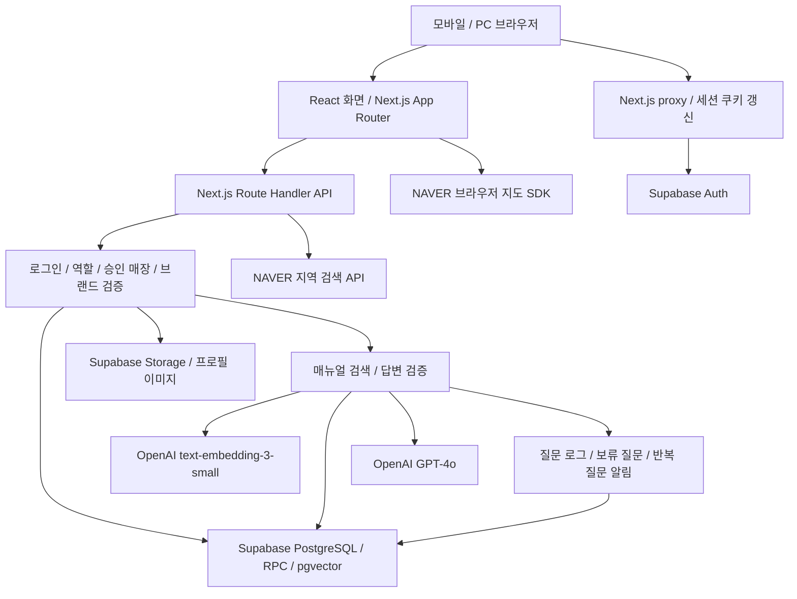
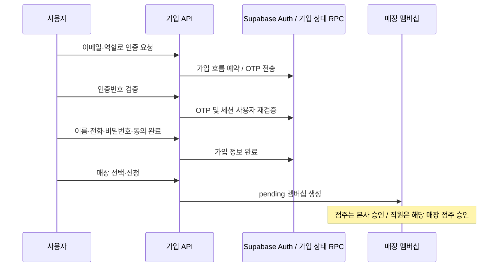

# 일잇다 시스템 동작 분석

분석일: 2026-10-13

## 1. 분석 범위와 판정 기준

현재 작업 공간의 소스 코드를 기준으로 화면, API, 인증, 데이터 모델, 매뉴얼 처리, AI 질문 처리, 알림, 외부 서비스, 실행 및 CI 구조를 분석했다.

- 확인한 라우트 파일: 화면 진입점 `page.tsx` 51개, API `route.ts` 86개.
- 확인한 SQL 마이그레이션 파일: 37개. 번호에 공백이 있으므로 마지막 번호가 실제 파일 수를 뜻하지 않는다.
- 이 숫자는 파일 수이며 고유 기능 수나 HTTP 메서드 수가 아니다.
- 환경변수 파일의 값, 실제 고객 데이터, 운영 로그는 읽지 않았다.
- 실제 DB 연결, 유료 OpenAI 호출, 이메일 발송, 외부 지도 호출, 운영 배포는 실행하지 않았다.
- 따라서 아래는 **코드에 구현된 동작 분석**이지, 운영 환경 전체가 정상이라는 인증 결과가 아니다.
- 모든 파일의 모든 분기를 감사한 결과도 아니다. 주요 진입점, 핵심 처리 경로 및 저장 계약을 중심으로 분석했다.
- 과거 인수인계 문서와 현재 코드가 다르면 현재 실행 코드를 우선했다.

## 2. 프로그램의 목적

일잇다는 본사 관리자, 점주, 직원이 매장 운영 정보를 공유하는 서비스다. 본사와 점주가 운영 매뉴얼과 공지를 관리하고, 직원은 승인받은 매장 범위 안에서 이를 조회하거나 매뉴얼 기반 AI에게 질문한다. AI가 답할 근거가 부족한 질문은 점주가 확인할 수 있는 운영 관리 흐름으로 연결된다.

| 사용자 | 주요 화면과 업무 | 데이터 접근 기준 |
|---|---|---|
| 본사 `hq` | 공통 매뉴얼, 지점 매뉴얼 관리 화면, 매장·점주 승인, 공지 작성, 알림, 설정 | 인증된 본사 프로필과 해당 프랜차이즈 범위 |
| 점주 `owner` | 운영 매장, 직원 승인·관리, 지점 매뉴얼, 공지, 보류·반복 질문, 알림, 설정 | 승인된 점주 매장 멤버십 |
| 직원 `staff` | AI 챗봇, 공통·지점 매뉴얼 조회, 근무 매장 관리·신청, 공지, 알림, 설정 | 승인된 직원 매장 멤버십 |

점주 화면의 URL은 `/owner`가 아니라 `/boss`이고, DB 역할 값은 `owner`다.

## 3. 전체 아키텍처



프론트엔드와 백엔드는 한 Next.js 프로젝트에 있다. 확인한 주요 경로에는 별도의 Express 서버, Python AI 서버, 자체 모델 학습 서버가 없다. AI 추론과 임베딩은 외부 OpenAI 서비스에 요청하며, 애플리케이션 서버는 접근 권한, 검색 범위, 근거 검증, 저장 및 후속 처리를 담당한다.

## 4. 기술 구성과 디렉터리 역할

| 계층 | 현재 구성 | 역할 |
|---|---|---|
| 웹 프레임워크 | Next.js 16.3.4 | 화면 라우팅, 서버 레이아웃, API, 쿠키 처리 |
| UI | React 19.2.8, TypeScript | 컴포넌트, 상태, 이벤트, 입력·응답 표시 |
| 스타일 | Tailwind CSS 4, CSS 변수, Lucide | 반응형 레이아웃, 테마, 아이콘 |
| 인증·DB | Supabase SSR / supabase-js | 세션, 사용자, PostgreSQL, Storage 접근 |
| 벡터 검색 | PostgreSQL pgvector + SQL RPC | 매뉴얼 청크 검색과 매장·브랜드 범위 제한 |
| 생성형 AI | OpenAI HTTP API | 질문 해석, 임베딩, 구조화 답변 생성 |
| 파일 처리 | xlsx, csv-parse 및 내부 파서 | Excel·CSV·문서 내용을 매뉴얼 구조로 변환 |
| 검증 | ESLint, TypeScript, Node 테스트, Playwright 의존성 | 정적 검사, 회귀 검사, 브라우저 검증 기반 |

버전 근거: [package.json](../package.json).

`app`은 화면과 API 진입점, `components`는 화면 구성 요소, `lib`는 권한·업무 규칙·서비스 처리, `supabase/migrations`는 DB 구조와 RPC, `scripts`와 `tests`는 검증 도구다. `docs`에는 운영·연결·인수인계 문서가 있으나 현재 코드와 일치하는지 따로 확인해야 한다.

Pinecone과 LangChain 패키지가 설치 의존성에 있으나, 확인한 실제 RAG 질문 경로는 이를 사용하지 않고 OpenAI HTTP 요청과 Supabase RPC를 사용한다. 패키지 설치만으로 해당 서비스가 실제 운영 중이라고 판단하면 안 된다.

## 5. 프론트엔드 동작

### 공통 구조

[app/layout.tsx](../app/layout.tsx)는 한국어 문서, 글꼴, 테마 공급자, 세션 만료 감시를 적용한다. 초기 테마 스크립트는 브라우저 저장값과 시스템 테마를 확인해 화면 깜빡임을 줄인다.

역할별 서버 레이아웃은 화면을 보여주기 전에 로그인과 역할을 확인한다. 예를 들어 [app/staff/layout.tsx](../app/staff/layout.tsx)는 직원 역할, 가입 완료 상태, 매장 승인 상태에 따라 직원 화면, 승인 대기 화면 또는 로그인으로 분기한다. 직원 레이아웃은 요청 시 판정하기 위해 `force-dynamic`이다.

### 직원 공통 상태

[components/staff/StaffShell.tsx](../components/staff/StaffShell.tsx)는 사이드바, 헤더, 본문을 구성하고, [components/staff/StaffShellContext.tsx](../components/staff/StaffShellContext.tsx)는 이름·역할·승인 매장·대기 신청·기본 매장·현재 선택 매장 등을 공유한다.

- 승인 매장은 `/api/staff/stores`에서 가져온다.
- 신청 상태는 `/api/signup/store-membership`에서 가져온다.
- 기본 매장과 정렬 설정은 `/api/staff/store-preferences`에서 조회·저장한다.
- 현재 업무 매장 선택은 탭 저장소를 사용하는 편의 상태이며, 권한의 근거가 아니다.
- 기본 매장은 계정 설정이고, 현재 업무 매장은 현재 작업 대상을 뜻한다. 두 값은 다를 수 있다.
- 확인한 현재 구현에서 챗봇과 직원 공지는 선택 매장을 사용하고, 지점 매뉴얼은 기본 매장을 사용한다. 제품 정책상 같은 매장이어야 하는지 별도 확인이 필요하다.

화면의 `useState`는 메뉴·모달·입력·선택·로딩 상태를 관리한다. 검색에는 디바운스와 `AbortController`를 사용해 연속 입력의 불필요한 요청을 줄인다. 서버로 전송하는 `storeId`, `userId`, 역할 값은 서버에서 다시 검증해야 한다.

최근 모바일 수정은 이 작업 공간에 포함된 상태를 기준으로 분석했다. `sm` 미만 전용 UI와 `sm` 이상 UI를 구분하지만, 이 문서는 모든 화면의 픽셀 단위 시각 검증 결과를 제공하지 않는다.

## 6. 백엔드 및 요청 처리

주요 API는 Next.js Route Handler로 구현돼 있다. AI, 업로드, 인증 관련 여러 경로는 `runtime = "nodejs"`를 명시한다. 브라우저는 `fetch`로 요청하고 서버는 JSON 또는 업로드 처리 결과를 반환한다.

일반적인 처리 순서는 다음과 같다.

1. JSON, query 또는 FormData를 읽고 형식을 검증한다.
2. 쿠키 기반 Supabase 사용자 세션을 확인한다.
3. 역할과 승인된 매장·프랜차이즈 범위를 검증한다.
4. DB 조회·RPC·외부 API 호출을 실행한다.
5. 필요한 후속 저장과 알림 처리를 수행한다.
6. 화면에 사용할 응답을 반환한다.

API마다 권한 검사와 응답 형식이 다르며, 모든 경로가 하나의 공통 가드를 사용하지는 않는다. 서버 레이아웃에서 차단한 것만으로 API 권한이 보장되는 것은 아니다.

### API 기능 지도

| 경로 묶음 | 주요 역할 |
|---|---|
| `/api/auth/*` | 로그인, 세션, 가입·OTP, OAuth, 계정 찾기, 비밀번호 변경, 동의 |
| `/api/signup/store-membership` | 본인 매장 신청 조회와 생성 |
| `/api/franchises/*`, `/api/stores/*` | 브랜드·매장 조회와 NAVER 매장 검색 |
| `/api/hq/*` | 본사 프로필, 매장·구성원, 승인, 공지 |
| `/api/boss/*` | 점주 프로필·계정, 직원 관리, 공지, 보류·반복 질문 |
| `/api/staff/*` | 직원 매장·설정, 매뉴얼·공지 조회, 대화, 계정·멤버십 |
| `/api/manuals/*` | 공통 매뉴얼 CRUD, 업로드·미리보기·확정, 검색 준비·재인덱싱 |
| `/api/store-manuals/*` | 지점 매뉴얼 CRUD, 분석·미리보기·확정, 일괄 작업·재인덱싱 |
| `/api/rag/query`, `/api/rag/upload` | AI 질문 및 RAG 관련 업로드 경로 |
| `/api/notifications/*` | 본인 알림 조회, 읽음·안 읽음, 단건·전체 삭제 |
| `/api/notices/[id]/read` | 공지 읽음과 조회수 처리 |
| `/api/profile/avatar/*` | 프로필 사진 업로드·삭제 |
| `/api/webhooks/index-manual` | 승인된 매뉴얼의 인덱싱 요청 수신 |

표는 기능별 진입점 분류이며, 모든 HTTP 메서드와 오류 분기를 열거한 API 명세는 아니다.

## 7. 인증, 가입, 승인

### 세션과 로그인

[proxy.ts](../proxy.ts)는 정적 리소스를 제외한 요청을 [lib/supabase/middleware.ts](../lib/supabase/middleware.ts)의 세션 처리로 연결한다. `auth.getUser()`로 사용자 확인과 필요한 토큰 갱신을 수행하고, 갱신된 쿠키를 응답에 반영한다. 세션이 무효하면 API는 세션 만료 응답을, 화면 요청은 로그인 리다이렉트를 받을 수 있다.

[lib/supabase/session-policy.ts](../lib/supabase/session-policy.ts)는 로그인 유지 정책을 HMAC 서명하고 실제 세션 ID와 연결한다. 브라우저가 정책 값을 임의로 변경한 경우 그대로 신뢰하지 않는다.

[app/api/auth/login/route.ts](../app/api/auth/login/route.ts)는 이메일·비밀번호를 Supabase Auth에 검증하고 프로필 역할·승인 상태를 읽는다. 이메일 미인증, 임시 비밀번호 변경 필요, 미완료 가입 정리 같은 상태도 처리한다.

### 역할과 데이터 권한

[lib/auth/require-server-role.ts](../lib/auth/require-server-role.ts)와 [lib/auth/server-role-guard-core.ts](../lib/auth/server-role-guard-core.ts)는 DB `profiles.role`을 역할 판단의 기준으로 사용한다. 일반적인 업무 권한을 요청 본문의 역할이나 `user_metadata`만으로 허용하지 않는다. 가입 초기화에는 별도 제한된 경로가 있다.

본사 권한은 [lib/supabase/hq-auth.ts](../lib/supabase/hq-auth.ts)에서 역할과 브랜드를 해석한다. 점주·직원은 각 기능에서 대상 매장에 대한 승인 멤버십을 검증한다.

### 이메일 가입 흐름



[lib/auth/email-first-signup.ts](../lib/auth/email-first-signup.ts)의 이메일 우선 흐름은 6자리 OTP, 서버 기준 180초 인증 창, 재전송 대기·중복 가입·역할 불일치 등을 다룬다. 공급자가 전송에 성공한 뒤 서버의 인증 창을 연다. Supabase 이메일 설정과 준비 플래그가 맞지 않으면 기능을 닫는다.

[app/api/auth/oauth/route.ts](../app/api/auth/oauth/route.ts)는 Google, Apple, Kakao, custom NAVER 공급자를 허용하며 origin과 Supabase 인증 URL을 검증한다. 실제 사용 가능 여부는 외부 공급자 및 Supabase 설정에 달려 있다.

매장 신청은 [app/api/signup/store-membership/route.ts](../app/api/signup/store-membership/route.ts)가 세션 사용자 기준으로 처리한다. [app/api/hq/approvals/route.ts](../app/api/hq/approvals/route.ts)는 해당 본사 브랜드의 점주 요청을, [app/api/boss/employees/[id]/route.ts](../app/api/boss/employees/%5Bid%5D/route.ts)는 해당 매장의 승인 점주가 직원 요청을 처리하도록 한다.

## 8. 데이터베이스 구조

Supabase PostgreSQL에 업무 데이터가 있고, Auth 사용자와 Storage 파일은 Supabase의 별도 기능으로 연결된다. SQL 마이그레이션은 테이블·인덱스·RLS·트리거·RPC를 정의한다.

| 엔티티 | 저장하는 정보 |
|---|---|
| Auth 사용자 / `profiles` | 인증 계정, 역할, 이름·연락처·브랜드·승인·아바타 정보 |
| `franchises` / `stores` | 브랜드와 실제 매장, 매장 브랜드 연결 |
| `store_memberships` / `store_approval_requests` | 사용자·역할·매장·신청·승인 관계 |
| `manuals` | 매뉴얼 주제와 세부 내용, 브랜드·매장 범위, 승인 상태 |
| `manual_chunks` | 매뉴얼 청크, 청크 순번, 1536차원 임베딩 |
| `manual_upload_batches` | 업로드 요청 식별, 내용 지문, 중복 저장 방지 상태 |
| `question_logs` | 질문·답변 판정과 점주 후속 관리 정보 |
| `conversations` / `conversation_messages` | 사용자 대화와 질문·답변 메시지 |
| `notices` / `notice_reads` | 공지 내용·대상·읽음 관계 |
| `notifications` | 사용자별 운영 이벤트 알림과 읽음 상태 |
| `repeated_question_alerts` | 반복 질문 그룹과 알림 회차 |
| 이메일 인증·가입 흐름 테이블 | OTP 및 가입 진행 상태 |

기존 `questions`, 이메일 인증·가입 관련 레거시 테이블도 마이그레이션에 존재한다. 테이블 존재와 현재 주 경로에서의 사용은 구분해야 한다.

다중 브랜드 프로필을 지원하는 마이그레이션과 코드가 있으므로 `profiles.id = auth user id`만 모든 경우의 유일한 규칙으로 가정하면 안 된다. 승인·가입 경로에서는 마스터 프로필과 브랜드 프로필을 구분하고 후속 상태를 동기화한다.

RLS 정책이 정의돼 있지만 서버의 admin 클라이언트는 강한 권한을 사용한다. [lib/supabase/admin.ts](../lib/supabase/admin.ts)를 쓰는 경로에서는 서버가 직접 수신자·사용자·매장·브랜드 조건을 정확히 제한하는 것이 중요하다.

## 9. 매뉴얼 업로드와 검색 준비

현재 확인한 미리보기 API는 `.txt`, `.md`, `.docx`, `.csv`, `.xlsx`, `.xls`를 허용하고 PDF는 거절한다. 과거 문서에 PDF가 언급돼 있어도 현재 지원한다고 볼 수 없다.

1. 파일 크기·형식을 검사하고 내용을 추출한다.
2. 카테고리·주제·세부 항목으로 분석한다.
3. 사용자가 미리보기에서 확인·수정한다. 이 단계는 매뉴얼을 DB에 저장하지 않는다.
4. 확인 API가 서버에서 권한과 매뉴얼 범위를 결정한다.
5. 업로드 배치 식별자와 내용 지문으로 같은 요청의 중복 저장을 막는다.
6. 부모 주제 카드와 자식 세부 매뉴얼을 저장한다.
7. 검색 대상 세부 내용에 청크와 임베딩을 생성한다.
8. DB 계약과 버전을 확인한 뒤 청크를 반영한다.
9. 저장 결과와 검색 준비 상태를 구분해 화면에 반환한다.

주요 근거: [미리보기 API](../app/api/manuals/preview/route.ts), [확정 API](../app/api/manuals/preview/confirm/route.ts), [매뉴얼 저장](../lib/rag/save-manual-sections.ts), [인덱싱](../lib/rag/index-approved-manual.ts).

[lib/manuals/analyze-manual-with-ai.ts](../lib/manuals/analyze-manual-with-ai.ts)는 이름과 일부 API 주석에 AI가 언급되지만, 실제 구현은 로컬 규칙·정규식·문단 분할 기반이며 외부 AI를 호출하지 않는다. **분류 단계와 임베딩 단계의 AI 비용을 구분해야 한다.**

[lib/rag/chunk-manual.ts](../lib/rag/chunk-manual.ts)의 기본 청크 목표는 800자, 최대 1200자, 겹침은 120자다. 토큰 수가 아니라 문자열 길이 기준이다. 부모 카드 자체는 검색 근거로 인덱싱하지 않는 정책이 적용된다.

[lib/manuals/manual-write-contract.ts](../lib/manuals/manual-write-contract.ts)는 DB RPC의 계약 버전 2를 확인한다. [037 마이그레이션](../supabase/migrations/037_owner_manual_safe_edit.sql)은 문서 변경 시 기존 청크를 무효화하고, 인덱싱은 `replace_manual_chunks_if_current`로 현재 문서 스냅샷일 때만 새 청크를 게시한다. 낡은 임베딩이 수정된 문서를 덮어쓰는 문제를 방지하기 위한 구조다.

문서 저장 성공과 임베딩·검색 반영 성공은 별개다. 한 세부 항목의 인덱싱 실패가 전체 저장을 무조건 취소하지 않으므로 검색 준비 상태 확인과 재인덱싱 경로가 필요하다.

## 10. AI 질문과 답변 시스템

### 실제 처리 흐름

```mermaid
flowchart TD
  Q[직원 질문] --> Chat[/api/staff/chat]
  Chat --> Owner[본인 대화 확인 / 유효 매장 결정]
  Owner --> RAG[/api/rag/query]
  RAG --> Scope[직원 승인 멤버십 / 프랜차이즈 확인]
  Scope --> Interpret[필요 시 질문·후속 맥락 해석]
  Interpret --> Embed[질문 임베딩]
  Embed --> Search[승인 매뉴얼 범위 제한 하이브리드 검색]
  Search --> Gate[근거 점수 / 대상 적합성 판정]
  Gate -->|답변 가능한 근거| Generate[GPT-4o 구조화 답변]
  Generate --> Verify[출처·인용·요구사항·수치·조건 검증]
  Verify --> Answer[answered / cautious / insufficient]
  Gate -->|근거 부족| Answer
  Interpret -->|추가 확인 필요| Clarify[clarification 응답]
  Answer --> Log[질문 로그 / 필요한 점주 알림]
  Log --> History[대화 메시지 저장 / 화면 응답]
```

[app/api/staff/chat/route.ts](../app/api/staff/chat/route.ts)는 대화 소유자를 확인한다. 기존 대화에서는 요청한 매장 ID 대신 대화에 저장된 매장 ID를 사용한다. 답변 성공 후 새 대화와 메시지를 저장하며, 저장이 실패해도 답변을 반환하고 기록 저장 실패를 별도 표시한다.

[app/api/rag/query/route.ts](../app/api/rag/query/route.ts)는 질문·매장 입력을 검사하고, 승인된 직원 멤버십과 서버가 조회한 브랜드 범위를 검증한다. 브랜드 범위를 확인하지 못하면 검색을 실행하지 않는다.

### 검색

- 임베딩 모델: `text-embedding-3-small`, 1536차원.
- 임베딩 요청 타임아웃: 30초.
- 검색 RPC: `match_manual_chunks_hybrid_scoped`.
- 범위: 같은 프랜차이즈의 HQ 공통 매뉴얼 + 해당 매장의 지점 매뉴얼.
- 승인되지 않았거나 유효 임베딩이 없는 문서는 검색 대상에서 제외된다.
- 질문 경로의 요청 결과 수는 5개다. 그중 후속 검증을 통과한 근거만 사용한다.
- 검색은 벡터 의미 유사도와 키워드 요소를 결합한다.

근거: [임베딩 모듈](../lib/rag/openai-embeddings.ts), [검색 모듈](../lib/rag/search-manual-chunks.ts).

### 답변 판정과 생성

[lib/rag/evidence-gate.ts](../lib/rag/evidence-gate.ts)는 검색 순위 점수와 답변 가능한 근거 점수를 분리한다. 원래 의미 유사도가 0.2 미만이면 키워드 가산을 주지 않고, 키워드 가산은 최대 0.15다.

질문 API가 전달하는 초기 기준은 근거 점수 0.60 이상 `answered`, 0.40 이상 `cautious`, 사용 가능한 근거 없음 `insufficient`다. **이 수치는 정답 확률이나 정확도 백분율이 아니다.** 생성 후 검증으로 상태가 더 낮아질 수 있다.

생성 모델은 GPT-4o, temperature 0.2, 최대 출력 2000토큰, 요청 타임아웃 30초다. 질문 해석에도 필요 시 GPT-4o를 별도로 호출하므로 질문 하나가 외부 AI 요청 하나와 같지 않다.

[lib/rag/resolve-rag-answer.ts](../lib/rag/resolve-rag-answer.ts)는 구조화 답변, 요구사항 충족, 근거 범위, 메뉴 대상, 조건·수치·인용 등을 검증한다. 질문이 모호하면 추가 확인 응답을 낼 수 있다. 레시피 관련 검증·출처 기반 렌더링과 선택적 저장 기능도 있다.

근거 부족은 정상적인 업무 결과이고, 검색 장애·생성 실패·구조화 응답 해석 실패는 시스템 오류다. 확인한 질문 경로는 시스템 오류를 근거 부족으로 위장하지 않고 500 오류로 반환하며, 해당 오류 때문에 점주에게 보류 질문 알림을 생성하지 않는다.

질문 로그와 반복 질문 후속 작업은 응답 전에 기다리므로 총 응답 시간은 검색·생성 시간뿐 아니라 DB 저장·알림 처리 시간에도 영향을 받는다. 개별 외부 호출의 30초 제한이 전체 요청의 30초 제한을 의미하지는 않는다.

### 학습과 데이터 전송

이 서비스의 개선 경로는 매뉴얼을 수정·추가하고 검색용 임베딩을 갱신하는 것이다. 직원 질문을 받았다고 자체 모델 가중치를 학습하는 시스템은 확인하지 않았다.

질문 임베딩에는 질문이 OpenAI로 전송되고, 답변 생성에는 질문과 선택된 매뉴얼 근거가 전송된다. 후속 질문 해석에는 제한된 대화 문맥도 사용될 수 있다. 외부 전송 데이터의 개인정보·영업정보 정책을 별도 관리해야 한다.

## 11. 공지, 알림, 점주 후속 처리

### 공지사항과 알림의 차이

공지사항은 본사·점주가 작성한 업무 문서이고, 알림은 승인·보류 질문·반복 질문 등 사용자에게 전달되는 이벤트 기록이다. 두 기능은 저장 테이블과 API가 다르다.

[app/api/staff/notices/route.ts](../app/api/staff/notices/route.ts)는 직원 역할과 선택 매장의 승인 멤버십을 확인한다. 매장 브랜드, 대상 범위, audience를 확인한 뒤 검색·출처·읽음·정렬·페이지 처리를 적용한다. 공지 읽음·조회수는 `notice_reads`와 연결된다. 현재 직원 UI에서는 대상 선택 컨트롤을 제거하고 전체 대상 기본값을 사용한다.

[app/api/notifications/route.ts](../app/api/notifications/route.ts)는 `recipient_user_id`를 세션 사용자로 제한한다. 기본 조회는 읽지 않은 알림이며, 전체 보기에서 읽은 알림을 포함할 수 있다. 읽음 수와 전체 수를 별도로 반환한다.

확인한 알림 패널은 열 때 목록을 조회하고, 애플리케이션 이벤트로 배지를 갱신한다. 그 경로는 WebSocket 기반 푸시 알림이나 OS 푸시를 전제로 하지 않는다.

### 보류 및 반복 질문

근거 부족 질문은 해당 매장의 승인 점주에게 후속 알림을 보낼 수 있다. 점주는 보류 질문을 확인하고 매뉴얼 보완 등의 업무 흐름을 진행한다. 이것이 자동 모델 학습을 의미하지는 않는다.

[lib/notifications/notify-repeated-question.ts](../lib/notifications/notify-repeated-question.ts)는 최근 7일에 정규화 키가 같은 질문이 3건 이상이면 반복 질문 알림을 판단한다. 답변 상태와 무관하게 검사하며, 의미만 비슷한 모든 문장을 합치는 방식은 아니다. DB 알림 회차와 수신자 중복 제한으로 중복 알림을 막는다.

후속 알림 실패가 직원 답변을 무효화하지 않도록 분리한다. 반복 알림의 실패분은 다음 탐지에서 다시 처리할 수 있지만, 이 모듈 자체에 상시 백그라운드 재시도 작업자는 없다.

## 12. 매장 검색, 지도, 프로필

[app/api/stores/search/route.ts](../app/api/stores/search/route.ts)는 NAVER API HUB 지역 검색에 요청하고 이름·주소·좌표를 정규화한다. 현재 구현은 최대 5개 결과를 반환한다. 브라우저 지도 SDK는 지도·핀·컨트롤을 그리는 별도 기능이다.

[lib/stores/search-stores.ts](../lib/stores/search-stores.ts)는 외부 검색 결과 ID와 실제 DB UUID를 구분한다. NAVER에서 검색됐다는 사실만으로 근무 가능한 DB 매장이나 승인된 소속이 되는 것은 아니다. 신청 API가 매장·역할·기존 점주 등 실제 업무 조건을 확인한다.

지도 공개 키는 실제 웹 접속 origin을 NAVER 콘솔에 등록해야 한다. PC의 localhost 등록만으로 모바일의 LAN 주소나 다른 배포 주소가 허용되지는 않는다.

[app/api/profile/avatar/upload/route.ts](../app/api/profile/avatar/upload/route.ts)는 세션 사용자 기준으로 JPEG·PNG·WebP 파일을 검증하고, 최대 5MB 제한을 적용한다. Supabase Storage에 사용자별 경로와 타임스탬프 파일명으로 업로드하고 프로필 URL을 갱신한다. 저장소 업로드와 프로필 DB 반영은 별도 단계이므로 둘 모두의 상태를 확인해야 한다.

## 13. 서버 실행, 설정, 외부 서비스

| 필요한 설정 | 용도 / 주의점 |
|---|---|
| `NEXT_PUBLIC_SUPABASE_URL`, `NEXT_PUBLIC_SUPABASE_ANON_KEY` | 브라우저·SSR 인증 연결용 공개 설정. 실제 데이터 보호는 권한과 RLS가 담당한다. |
| `SUPABASE_SERVICE_ROLE_KEY` 또는 지원되는 `SUPABASE_SECRET_KEY` | 서버 관리자 DB 접근. 브라우저 공개 변수로 만들면 안 된다. |
| `OPENAI_API_KEY` | 질문 임베딩·해석·생성과 문서 임베딩 |
| `NAVER_SEARCH_CLIENT_ID`, `NAVER_SEARCH_CLIENT_SECRET` | 서버 NAVER 지역 검색 |
| `NEXT_PUBLIC_NAVER_MAP_KEY_ID` | 브라우저 지도 SDK. 기존 client ID 이름은 호환 경로가 있다. |
| `AUTH_SESSION_POLICY_SECRET` | 세션 정책 서명. 현재 구현에는 서버 관리자 키 대체 경로도 있다. |
| `WEBHOOK_SECRET` | 매뉴얼 인덱싱 웹훅 인증 |
| OTP 준비 플래그·Supabase 이메일 설정 | 이메일 가입 동작 여부 |
| RAG 진단·저장 선택 플래그 | 개발 진단 및 선택적 증거 저장 기능 |

이 표는 코드에서 확인한 대표 설정 이름이다. 전체 환경변수 명세나 현재 값의 유효성 검증 결과는 아니다. 일부 내부 경로는 관리자 키를 읽는 방식이 다르므로, 대체 키 이름 하나만 설정했을 때 모든 경로가 동일하게 동작한다고 가정하면 안 된다.

개발은 `npm run dev`, 운영 빌드는 `npm run build`, 빌드 후 서버 실행은 `npm run start`다. 실제 호스팅 사업자·운영 URL·인스턴스 수·리전은 코드만으로 확정할 수 없다.

[next.config.ts](../next.config.ts)는 개발 origin과 운영 파일 추적 제외를 설정하고, 격리된 PoC 빌드 옵션을 제공한다. `local-data`와 개발 진단 출력은 운영 번들 추적에서 제외하도록 설정돼 있다. 확인한 저장소 파일 검색에서는 별도 Docker·Compose·Vercel 배포 설정 파일을 찾지 못했다. 이것만으로 외부 호스팅이 없다고 판단할 수는 없다.

[app/api/webhooks/index-manual/route.ts](../app/api/webhooks/index-manual/route.ts)는 공유 비밀을 일정 시간 비교 방식으로 검증하고 승인 매뉴얼 이벤트를 인덱싱한다. 인덱싱 실패를 HTTP 200과 `success: false`로 반환하는 분기가 있으므로, 운영 감시는 HTTP 성공 여부만 보지 말고 응답 결과와 검색 준비 상태까지 봐야 한다.

## 14. 품질 검사와 운영상 확인 사항

[.github/workflows/ci.yml](../.github/workflows/ci.yml)은 `main`·`develop` PR 및 push에서 Node.js 24 환경으로 의존성을 설치하고 RAG 테스트, 평가 도구 테스트, 예제 데이터 검증, 프론트엔드 품질 검사를 실행하도록 설정돼 있다. 프론트엔드 검사에는 lint·typecheck·build·충돌·공백·구조 회귀 검사가 포함된다.

현재 저장소에는 인증, 가입, 매뉴얼, 검색 범위, 근거 검증, 점주 후속 처리, 알림, 프론트엔드 경계 관련 테스트가 있다. 테스트 파일과 CI 정의가 있다는 사실은 이번 분석에서 모든 검사를 통과했다는 뜻이 아니다. 이번 요청은 소스 분석으로 수행했고 전체 검증 명령은 실행하지 않았다.

운영 전 우선 확인 사항은 다음과 같다.

1. **DB 계약 배포**: scoped 검색 RPC, 계약 버전 2, 원자적 청크 게시 RPC와 관련 트리거가 실제 DB에 적용돼 있는가.
2. **검색 준비 데이터**: 승인 매뉴얼에 유효한 청크가 있고, 매장 브랜드 연결과 scope 값이 올바른가.
3. **가입·이메일**: 실제 SMTP/메일 템플릿, OTP 정책, OAuth callback과 공급자 설정이 코드 계약과 맞는가.
4. **서버 권한**: admin DB 클라이언트를 쓰는 API에서 역할·사용자·매장·브랜드 검사가 빠지지 않았는가. 이번 분석은 86개 API 전체 보안 감사가 아니다.
5. **비용·남용 방지**: 확인한 지역 검색 핸들러는 자체 세션 검사와 호출 제한을 두지 않는다. 확인한 일반 RAG 질문 경로에도 포괄적인 사용자별 과금 한도는 보이지 않는다. 외부/WAF 설정 여부는 미확인이다. 발표용 제한 정책은 일반 운영 호출 제한과 별개다.
6. **지연·재시도**: AI 다단계 요청, 임베딩, DB 후속 저장은 시간이 누적된다. 서버의 전체 실행 시간 제한과 실패 재처리 기준을 확인해야 한다.
7. **외부 전송·로그**: 질문·선택 문서의 OpenAI 전송 정책, 로그 접근·보존·삭제 정책을 정해야 한다. 일부 경로는 안전한 오류 코드 로깅을 쓰지만 모든 모듈의 로그가 같은 수준으로 제한된 것은 아니다.
8. **기본/선택 매장 의미**: 챗봇·공지·지점 매뉴얼의 매장 기준이 제품 정책과 일치하는가.
9. **배포 확인**: CI 통과, Vercel Git 연결, 실제 배포 완료, 운영 DB 준비는 서로 별개의 확인 단계다.
10. **검색 확장성**: 임베딩 비용, 벡터 인덱스 설정, 매뉴얼 계층 쓰기의 DB 잠금, 대량 공지 조회 후 애플리케이션 필터 처리의 성능을 실제 데이터 규모로 측정해야 한다.

## 15. 결론

이 시스템은 **역할·매장·브랜드 권한으로 범위를 제한하는 매장 운영 서비스에, 매뉴얼 근거 검증형 AI와 점주 후속 처리 흐름을 결합한 구조**다.

핵심 연결은 `사용자 화면 -> Next.js API -> 인증·소속 검증 -> Supabase 데이터/RPC -> 필요한 외부 API -> 후속 저장 -> 화면 응답`이다. AI는 이 흐름 안의 외부 추론 서비스이며 DB·권한·매뉴얼 품질을 대신하지 않는다.

프론트엔드 화면이 정상이고 로그인에 성공하더라도, DB RPC 미적용·검색 청크 누락·브랜드 연결 오류·이메일 설정 불일치·외부 API 장애가 있으면 해당 업무 기능은 실패할 수 있다. 따라서 배포 검증은 화면, API, DB 계약, 외부 서비스, 검색 준비 데이터를 각각 확인해야 한다.